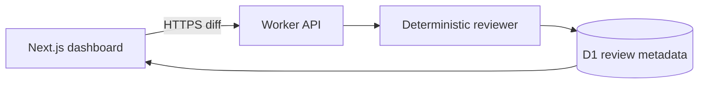
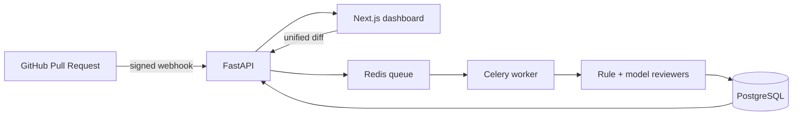

# ReviewForge

**Evidence-driven pull request review for engineering teams.** ReviewForge accepts a unified diff or a signed GitHub pull-request webhook, identifies high-confidence risks, and returns line-level findings with concrete fixes and an auditable score.

**[Try the live demo](https://reviewforge-kylin.daintygoby.chatgpt.site)** — paste a unified diff and receive an instant review. The hosted server analyzes the diff and stores the score, findings, and review metadata in a durable D1 database; the submitted diff is transmitted over HTTPS but is not persisted. The Docker stack provides the reference FastAPI/PostgreSQL implementation with GitHub webhooks and background jobs.

## Why this project exists

AI code-review demos often produce confident comments without showing how the result was derived. ReviewForge starts with a deterministic, testable rule engine and treats model output as an optional reviewer rather than an unquestioned authority. Every finding includes a source line, category, severity, confidence, explanation, and recommendation.

## Features

- Interactive Next.js dashboard for reviewing a pasted pull-request diff
- FastAPI service with generated OpenAPI documentation
- Security, reliability, and maintainability rules with confidence scores
- HMAC-SHA256 verification for GitHub webhooks
- PostgreSQL audit history with a SQLite zero-configuration development mode
- Redis and Celery for asynchronous GitHub pull-request analysis
- Docker Compose development environment
- Unit tests and GitHub Actions CI

## Architecture

The public demo uses a same-origin edge API and D1 so it can persist review history without retaining submitted source:



The repository also includes a containerized reference architecture for team deployments:



## Run the full stack

1. Copy the environment template and choose a webhook secret.

   ```bash
   cp .env.example .env
   ```

2. Start the application.

   ```bash
   docker compose up --build
   ```

3. Open the dashboard at `http://localhost:3000` and API documentation at `http://localhost:8000/docs`.

The sample diff works without a GitHub or model API key.

## Run backend tests

```bash
cd backend
python -m venv .venv
source .venv/bin/activate
pip install ".[dev]"
pytest
```

## API

### Analyze a diff

```bash
curl -X POST http://localhost:8000/api/reviews/analyze \
  -H 'Content-Type: application/json' \
  -d '{"repository":"owner/repo","pull_request":7,"diff":"@@ -1 +1 @@\n+eval(input())"}'
```

### GitHub webhook

Configure a repository webhook for `http://YOUR_HOST/api/github/webhook`, choose `application/json`, and provide the same secret as `GITHUB_WEBHOOK_SECRET`. ReviewForge handles `opened`, `reopened`, and `synchronize` pull-request events.

## Evaluation plan

The deterministic engine is tested against small, labeled diffs. The next milestone adds a public benchmark of seeded bugs and reports precision, recall, false-positive rate, latency, and cost for each reviewer configuration. Metrics will be published only after they are reproducibly measured.

## Security and limitations

- Diff size is limited to 250 KB at the API boundary.
- Webhooks are rejected unless the HMAC signature matches.
- Findings are suggestions for human reviewers, not approval decisions.
- The rule engine currently inspects added lines and does not build a full program dependency graph.
- Never submit proprietary source code to an external model without authorization.

## Roadmap

- [ ] GitHub App installation flow and inline review comments
- [ ] LLM reviewer with structured outputs and prompt-injection defenses
- [ ] Seeded-bug evaluation dataset and reproducible benchmark report
- [ ] OpenTelemetry traces and queue latency dashboard
- [ ] Terraform deployment for AWS ECS, RDS, ElastiCache, and S3

## Author

Built by **Kylin Xiong**, a University of Washington computer science student interested in applied AI, reliable software systems, and computer vision.
